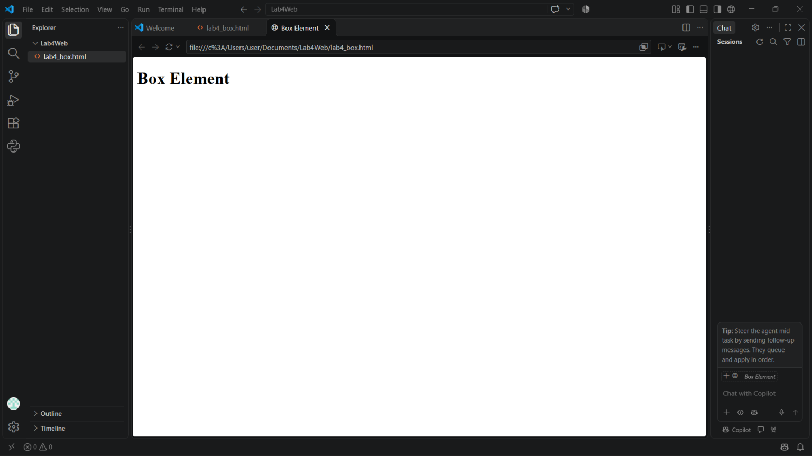
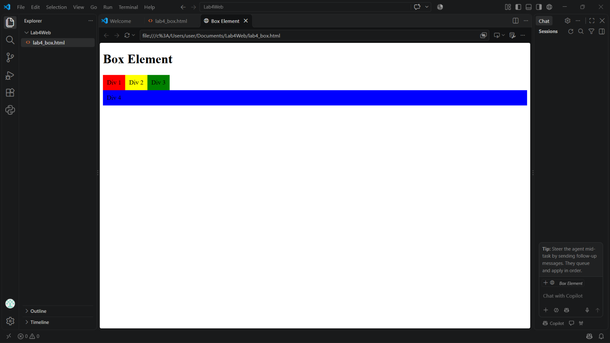
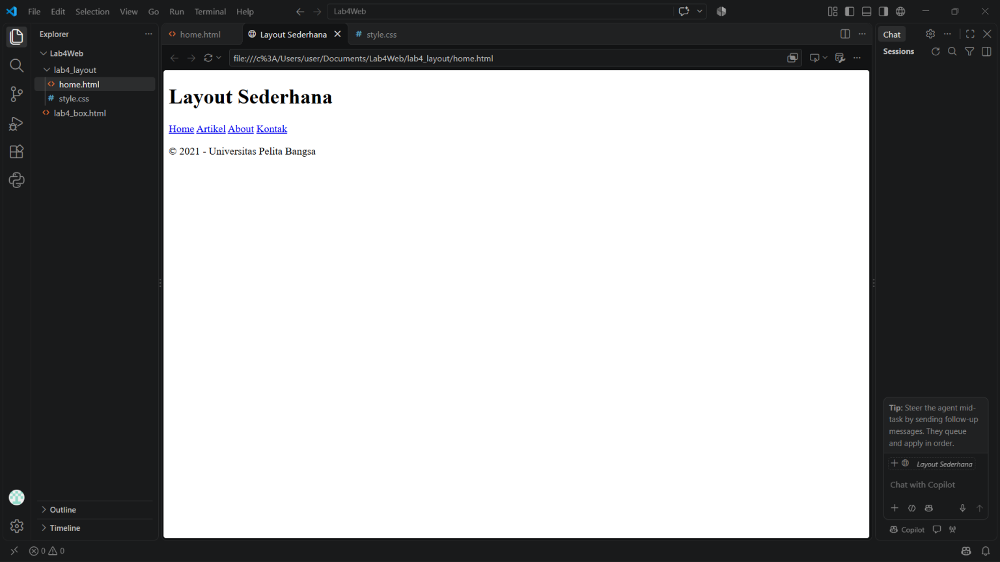
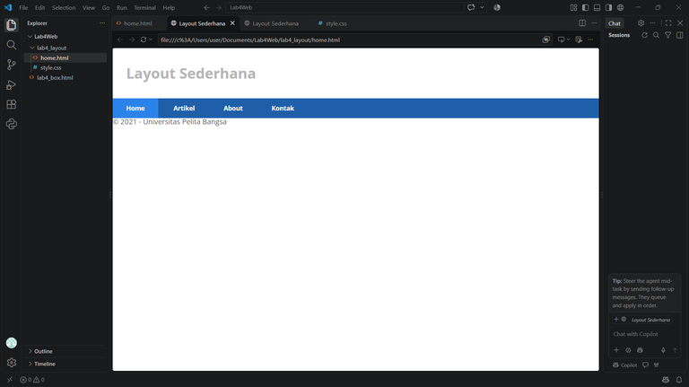
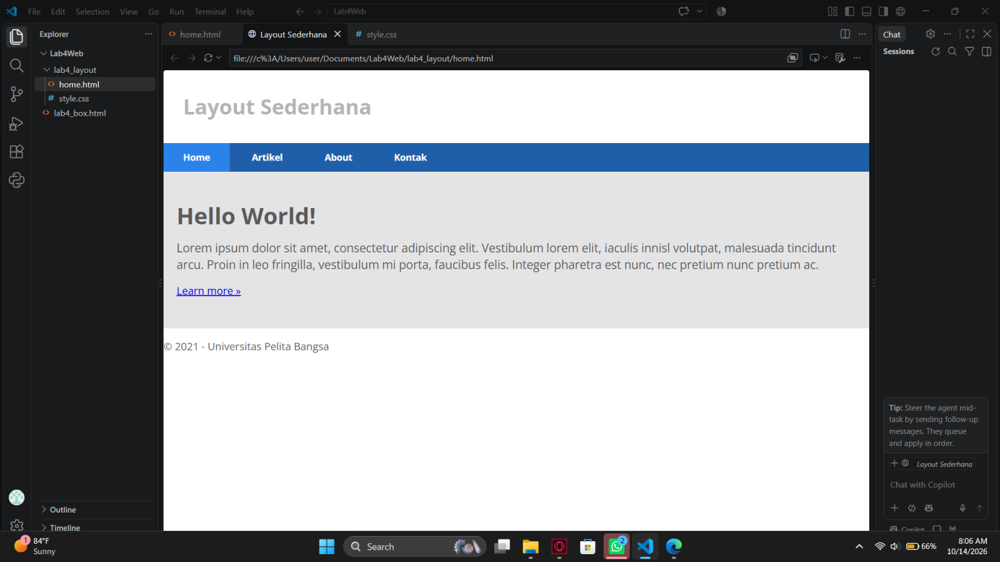
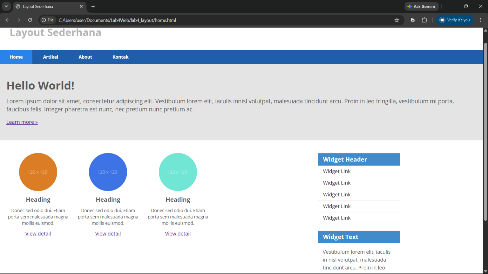
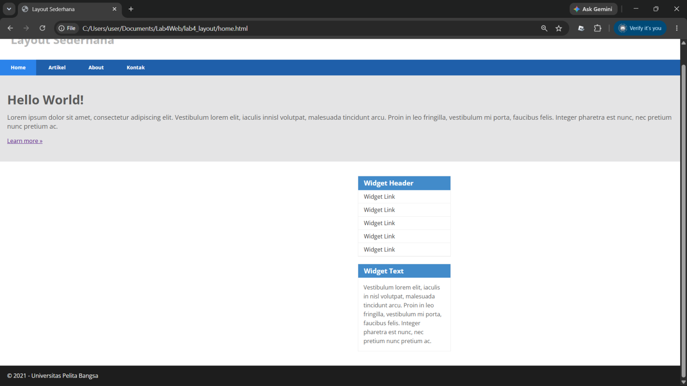
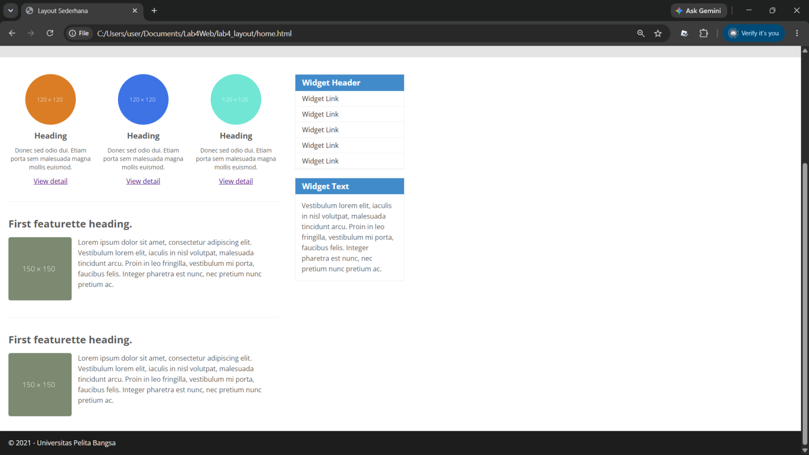
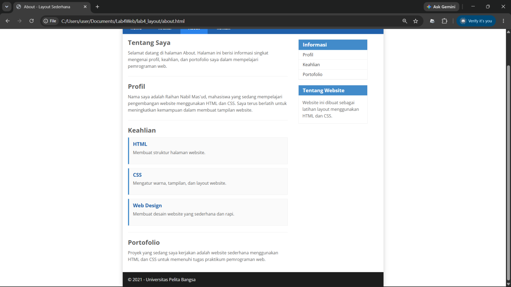
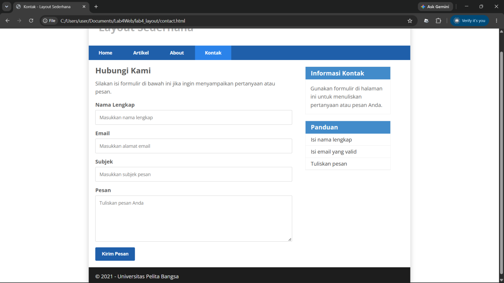

# Praktikum 4 — CSS Layout Lanjutan

Repository ini berisi hasil pengerjaan Praktikum 4 mata kuliah Pemrograman Web. Praktikum ini membahas pembuatan layout website menggunakan HTML dan CSS, konsep box element, CSS float, clearfix, serta HTML5 semantic elements.

## Tujuan Praktikum

1. Memahami struktur dasar pembuatan layout.
2. Memahami konsep box element.
3. Memahami penggunaan CSS float.
4. Memahami HTML5 semantic elements.
5. Membuat layout website sederhana.
6. Menambahkan halaman About dan Contact pada website.

## Langkah-Langkah Praktikum

### 1. Membuat Box Element

Box element merupakan konsep yang memperlakukan elemen HTML sebagai kotak. Konsep ini terdiri dari content, padding, border, dan margin.

Pada tahap ini dibuat beberapa elemen `div` untuk memahami bagaimana elemen HTML ditampilkan dalam halaman web.

**Screenshot:**

### 2. Menggunakan CSS Float

CSS `float` digunakan untuk mengatur posisi elemen agar dapat berada di sisi kiri atau kanan elemen lain.

Pada latihan ini, beberapa elemen `div` diatur menggunakan properti `float: left`.

**Screenshot:**

### 3. Mengatur Clearfix

Properti `clear` digunakan untuk mengatur posisi elemen setelah elemen yang menggunakan float. Pada latihan ini digunakan `clear: left` agar elemen berikutnya berada di bawah elemen yang mengambang di sebelah kiri.

**Screenshot:**

### 4. Membuat Kerangka Layout Website

Pada tahap ini dibuat layout dasar website menggunakan HTML5 semantic elements, seperti `header`, `nav`, `section`, `aside`, dan `footer`.

File yang digunakan adalah `home.html` dengan stylesheet `style.css`.

**Screenshot:**

### 5. Membuat Navigasi

Navigasi dibuat menggunakan elemen `nav` dan tautan `a` untuk menghubungkan halaman Home, Artikel, About, dan Kontak.

CSS digunakan untuk mengatur warna latar belakang, ukuran teks, padding, serta efek hover pada menu navigasi.

**Screenshot:**

### 6. Membuat Hero Panel

Hero panel merupakan bagian utama yang menampilkan judul, deskripsi, dan tautan. Pada praktikum ini, hero panel dibuat menggunakan elemen `section` dengan ID `hero`.

**Screenshot:**

### 7. Mengatur Main Content dan Sidebar

Layout utama dibagi menjadi area konten dan sidebar menggunakan properti CSS `float`.

Area main digunakan untuk menampilkan konten utama, sedangkan sidebar digunakan untuk menampilkan informasi tambahan.

**Screenshot:**

### 8. Membuat Sidebar Widget

Sidebar dilengkapi widget yang berisi daftar tautan dan informasi tambahan. Widget menggunakan elemen HTML dan CSS untuk mengatur judul, isi, serta tampilan tautan.

**Screenshot:**

### 9. Mengatur Footer

Footer merupakan bagian bawah website yang menampilkan informasi penutup. Pada praktikum ini, footer diberi warna latar belakang gelap, padding, dan warna teks terang.

Properti `clear: both` digunakan agar footer berada di bawah elemen yang menggunakan float.

**Screenshot:**

### 10. Menambahkan Content Artikel

Pada tahap ini ditambahkan konten artikel menggunakan elemen `article`. Gambar dan teks diatur menggunakan CSS, termasuk properti float untuk menempatkan gambar di sisi kiri atau kanan teks.

**Screenshot:**

### 11. Membuat Halaman About

Halaman About dibuat untuk menampilkan informasi mengenai profil, keahlian, dan portofolio. Halaman ini menggunakan layout utama yang sama dengan Home, termasuk header, navigasi, main content, sidebar, dan footer.

**Screenshot:**

### 12. Membuat Halaman Contact

Halaman Contact dibuat untuk menyediakan formulir yang berisi nama lengkap, email, subjek, dan pesan.

Formulir menggunakan elemen `form`, `label`, `input`, `textarea`, dan `button`. CSS digunakan untuk mengatur tampilan formulir agar rapi dan konsisten dengan layout website.

**Screenshot:**

**Catatan:** Formulir Contact pada praktikum ini merupakan antarmuka HTML. Pengiriman pesan belum terhubung ke backend atau server.

## Kesimpulan

Melalui praktikum ini, konsep dasar layout website dapat dipelajari dengan menggunakan HTML dan CSS. Penggunaan box element, float, clearfix, semantic elements, navigasi, main content, sidebar, dan footer membantu membentuk struktur halaman web yang teratur.

Penambahan halaman About dan Contact melengkapi website dengan informasi profil, portofolio, serta formulir kontak.